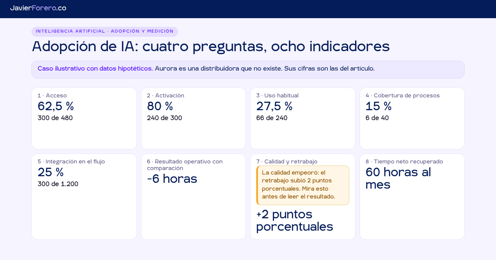

[Español](README.md) · **English**

# AI adoption scorecard · four questions, eight metrics

[](https://dashboards.javierforero.co/adopcion-ia/?lang=en)
[](../LICENSE)
[](#files)
[](https://dashboards.javierforero.co/adopcion-ia/)

The question it answers: **does your company have AI, use it, build it into its processes and get results?** Those are four different facts, and none follows from the one before. It goes with the article "Measuring AI adoption: it is not one percentage, it is four questions" (javierforero.co).

> **Illustrative case with hypothetical data.** Northgate Supply (Aurora in Spanish) is a distributor that does not exist. Its numbers are the ones in the article. Framework and scorecard are the author's own work: this is not a standard and it has not been comparatively validated.



## Two uses
1. **Browsable example.** The case from the article, with the same numbers.
2. **Working template.** Download five CSV templates, fill them with your company's records, load them and get your own metrics. **Your files are processed in your browser. They are not sent to any server and they are not stored.**

## Design principle: traceable facts, not perceptions
- No metric uses surveys or self-reported data. Vendor "assisted hours" and "estimated value" are ignored if a file includes them.
- Every card has **"See where it comes from"**: formula, numerator, denominator, window, file, row count and a download of the aggregated subset (never per person).
- **No data, no number.** If a file or a column is missing, the card says "No data" and which record is missing. Nothing is imputed or filled with zeros.
- No composite index, no traffic lights, no outside targets, no per-person data. No value for groups of fewer than 5 people.

## Metrics
| # | Metric | Formula | File |
|---|---|---|---|
| 1 | Access | eligible with access ÷ eligible | people |
| 2 | Activation | with access and ≥ 1 action in 28 days ÷ with access | people, weekly_usage |
| 3 | Habitual use | active in ≥ 9 of 12 weeks ÷ with ≥ 1 active week (also over eligible) | people, weekly_usage |
| 4 | Process coverage | with a verified use case (≥ 2 pieces of evidence) ÷ where AI is applicable | processes |
| 5 | Workflow integration | Σ assisted ÷ Σ closed, last 4 weeks of the "after" period for the group with AI | units |
| 6 | Operating outcome against a comparison | (after − before with AI) − (after − before in comparison) | units |
| 7 | Quality and rework | the same double subtraction on the rework rate, in percentage points | units |
| 8 | Net time recovered | (drop in drafting minutes − rise in review minutes) × assisted units in the last 4 weeks | units |

Alerts (not metrics): **concentration** (actions from the most active 10%) and **use outside the tools you provide** (`alerts.csv`).

Templates accept Spanish or English column names (`data/plantillas/` and `data/plantillas/en/`).

## Files
| File | Role |
|---|---|
| `index.html` | Page and styles (site tokens, light and dark theme) |
| `calc.js` | Dependency-free engine: CSV, validation, the eight metrics, alerts and readings. Runs the same in the browser and in Node |
| `app.js` | Screens, hand-built SVG charts, file loading and downloads |
| `i18n.js` | ES/EN strings by key |
| `data/ejemplo/` | The five CSV files of the illustrative case and `etiquetas-en.js` (same data, English labels) |
| `data/plantillas/` | Templates in Spanish, `en/` in English, and column dictionaries |
| `tools/generar-datos.js` | Generates all of `data/` from a fixed seed |
| `tools/probar.js` | Recomputes the eight values from the CSV files and fails if any does not match |

## Tests
```bash
node adopcion-ia/tools/generar-datos.js   # regenerates data/ (deterministic)
node adopcion-ia/tools/probar.js          # 54 checks; exit code 1 if any fails
```

## Privacy and analytics
GA4 records the visit, as on the rest of the site. Switching to "My data" sets `ga-disable` before any file is read. Loaded data lives in memory only: no `fetch`, `localStorage`, cookies or IndexedDB touch it. Only the `jf-lang` and `jf-theme` preferences are stored.
