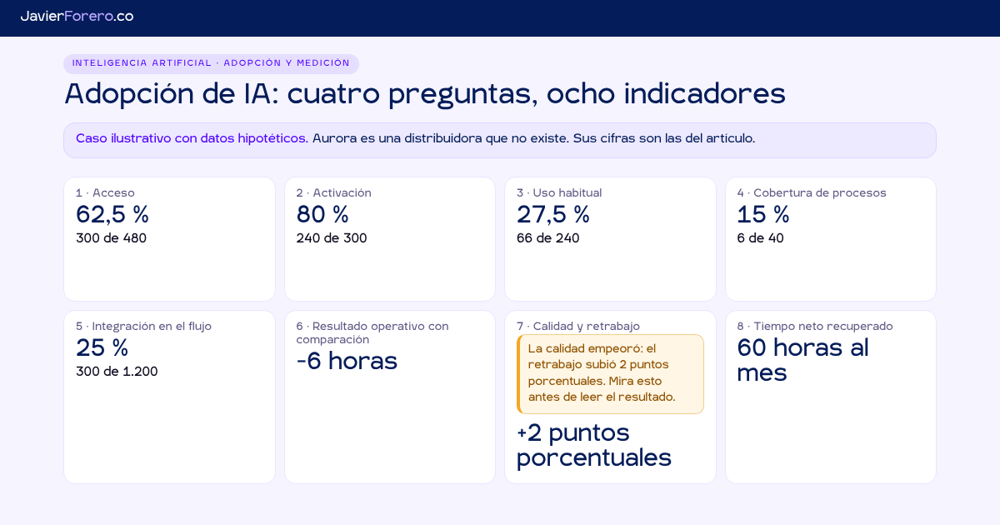

**Español** · [English](README.en.md)

# Tablero de adopción de IA · cuatro preguntas, ocho indicadores

[](https://dashboards.javierforero.co/adopcion-ia/)
[](../LICENSE)
[](#archivos)
[](https://dashboards.javierforero.co/adopcion-ia/?lang=en)

La pregunta que responde: **¿tu empresa tiene IA, la usa, la integró en sus procesos y obtiene resultados?** Son cuatro hechos distintos y ninguno se deduce del anterior. Acompaña el artículo [«Medir la adopción de IA: no es un porcentaje, son cuatro preguntas»](https://javierforero.co/2026/11/14/medir-adopcion-ia-kpis/).

> **Caso ilustrativo con datos hipotéticos.** Aurora (Northgate Supply en inglés) es una distribuidora que no existe. Sus cifras son las del artículo. Marco y tablero de elaboración propia: no es un estándar ni está validado comparativamente.



## Dos usos
1. **Ejemplo navegable.** El caso del artículo, con los mismos números.
2. **Plantilla real.** Descargas cinco plantillas CSV, las llenas con registros de tu empresa, las cargas y obtienes tus indicadores. **Tus archivos se procesan en tu navegador. No se envían a ningún servidor ni se guardan.**

## Principio de diseño: hechos trazables, no percepciones
- Ningún indicador usa encuestas ni datos declarados. Las «horas asistidas» y el «valor estimado» del proveedor se ignoran si vienen en un archivo.
- Cada tarjeta tiene **«Ver de dónde sale»**: fórmula, numerador, denominador, ventana, archivo, número de filas y descarga del subconjunto agregado (nunca por persona).
- **Sin datos, sin número.** Si falta un archivo o una columna, la tarjeta dice «Sin datos» y qué registro falta. Nada se imputa ni se rellena con ceros.
- Sin índice compuesto, sin semáforos, sin metas externas, sin datos por persona. Ningún valor para grupos de menos de 5 personas.

## Indicadores
| # | Indicador | Fórmula | Archivo |
|---|---|---|---|
| 1 | Acceso | elegibles con acceso ÷ elegibles | personas |
| 2 | Activación | con acceso y ≥ 1 acción en 28 días ÷ con acceso | personas, uso_semanal |
| 3 | Uso habitual | activas en ≥ 9 de 12 semanas ÷ con ≥ 1 semana activa (y sobre elegibles) | personas, uso_semanal |
| 4 | Cobertura de procesos | con caso de uso verificado (≥ 2 evidencias) ÷ con IA aplicable | procesos |
| 5 | Integración en el flujo | Σ asistidas ÷ Σ cerradas, últimas 4 semanas del periodo «después» del grupo con IA | unidades |
| 6 | Resultado operativo con comparación | (después − antes con IA) − (después − antes en comparación) | unidades |
| 7 | Calidad y retrabajo | la misma resta doble sobre la tasa de retrabajo, en puntos porcentuales | unidades |
| 8 | Tiempo neto recuperado | (baja de minutos de elaboración − alza de minutos de revisión) × unidades asistidas de las últimas 4 semanas | unidades |

Alertas (no son indicadores): **concentración** (acciones del 10 % más activo) y **uso fuera de las herramientas provistas** (`alertas.csv`).

**Decisión de diseño sobre el indicador 5.** Se calcula sobre las últimas 4 semanas del periodo «después», la misma ventana del indicador 8: describe el estado actual y no el promedio desde el arranque. La tarjeta también muestra la tasa de todo el periodo. La constante es `semanasMes` en `calc.js`.

## Archivos
| Archivo | Rol |
|---|---|
| `index.html` | Página y estilos (tokens del sitio, tema claro y oscuro) |
| `calc.js` | Motor de cálculo sin dependencias: CSV, validación, los ocho indicadores, alertas y lecturas. Corre igual en el navegador y en Node |
| `app.js` | Pantallas, gráficos SVG propios, carga de archivos y descargas |
| `i18n.js` | Textos ES/EN por clave. Al cambiar un texto, sube el `?v=` en `index.html` |
| `data/ejemplo/` | Los cinco CSV del caso ilustrativo y `etiquetas-en.js` (los mismos datos con nombres en inglés) |
| `data/plantillas/` | Plantillas en español, `en/` en inglés, y diccionarios de columnas |
| `tools/generar-datos.js` | Genera todo `data/` con semilla fija |
| `tools/probar.js` | Recalcula los ocho valores desde los CSV y falla si alguno no coincide |

## Pruebas
```bash
node adopcion-ia/tools/generar-datos.js   # regenera data/ (determinista)
node adopcion-ia/tools/probar.js          # 54 comprobaciones; código 1 si alguna falla
```
La página también está en las pruebas de humo del repositorio (`.github/smoke/smoke.js`, id `adopcion-ia`).

## Valores esperados con el caso ilustrativo
Acceso 62,5 % (300 de 480) · Activación 80 % (240 de 300) · Uso habitual 27,5 % (66 de 240) y 13,75 % sobre elegibles · Cobertura 15 % (6 de 40) · Integración 25 % (300 de 1.200) · Resultado −6 horas, −12 % · Calidad +2 puntos porcentuales, con alerta · Tiempo neto 60 horas al mes.

Dos cifras del caso no están en el artículo y son parámetros del generador: concentración 58 % y 9 servicios no autorizados con tráfico.

## Privacidad y analítica
GA4 `G-MQ3K8EVKV0` registra la visita, como en el resto del sitio. Al pasar a «Mis datos» se activa `ga-disable` antes de leer cualquier archivo. Los datos cargados viven en memoria: no hay `fetch`, `localStorage`, cookies ni IndexedDB con ellos. Solo se guardan las preferencias `jf-lang` y `jf-theme`.
