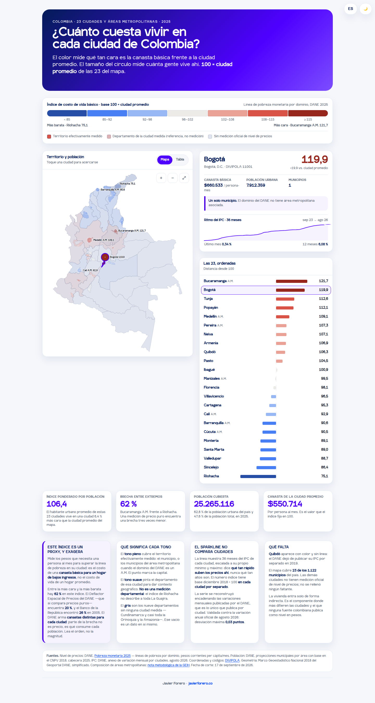

**Español** · [English](README.en.md)

# Costo de Vida en Colombia

[Ver el mapa en vivo](https://dashboards.javierforero.co/claude/costo-vida-colombia/) ·
[versión en inglés](https://dashboards.javierforero.co/claude/costo-vida-colombia/?lang=en)

Mapa interactivo del costo de una canasta básica en **23 ciudades y áreas metropolitanas**
colombianas (44 municipios). Color = índice de costo (base 100 = ciudad promedio del año).
Tamaño del círculo = población urbana del dominio. El color cubre el territorio completo del
área metropolitana; el punto marca la capital. Un filtro de año recorre 2021-2025.

**Fecha de corte:** 18 de septiembre de 2026 · archivo único: la tipografía y los datos van
embebidos; la única llamada externa es la analítica (GA4), que no hace falta para que funcione.
Español e inglés, tema claro y oscuro.

## Qué mide

La línea de pobreza monetaria por dominio geográfico del DANE (2021-2025), en pesos corrientes
per cápita/mes. Es un **proxy**: el costo de una canasta básica para un hogar de bajos ingresos, no
el costo de vida de un hogar promedio. Entre extremos hay 62 % en este índice (2025); el Deflactor
Espacial de Precios del DANE, que compara precios puros, encuentra 20 %. **Lea el orden, no la
magnitud.**

## Datos

| Archivo | Contenido |
|---|---|
| `data/archivo_a_nivel_precios_poblacion.csv` | 23 filas: índice, pesos, población, coordenadas |
| `data/archivo_a_serie_anual.csv` | 115 filas: índice y pesos por ciudad, 2021-2025, con fuente por fila |
| `data/archivo_b_ipc_mensual.csv` | 792 filas: IPC mensual por ciudad, 36 meses |
| `data/areas_metropolitanas.csv` | Composición municipal de los 7 dominios A.M. |
| `data/cobertura_cruce.csv` | Cruce nivel ↔ IPC por `codigo_divipola` |
| `data/contraste_dep_dane.csv` | Contraste contra el Deflactor Espacial de Precios |
| `data/fuentes_inventario.csv` | Inventario de fuentes con veredicto y URL |
| `data/notas_metodologicas.md` | Supuestos, límites y fecha de corte |

## Fuentes

DANE — Pobreza monetaria 2021-2025 · Proyecciones de población municipal por área (CNPV 2018) ·
IPC anexo de ciudades, agosto 2026 · DIVIPOLA · Marco Geoestadístico Nacional 2018 (simplificado
y republicado por el repositorio `caticoa3/colombia_mapa`) · nota metodológica de la GEIH para la
composición de las áreas metropolitanas.
