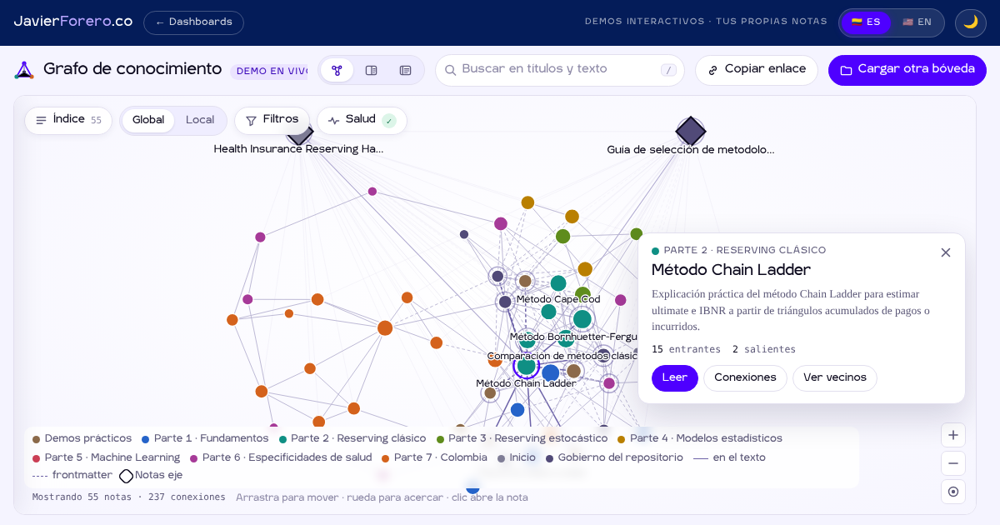

**Español** · [English](README.en.md)

# Grafo de conocimiento · tus notas como red navegable

[](https://dashboards.javierforero.co/claude/grafo-conocimiento/)
[](../../LICENSE)
[](https://d3js.org/)
[](https://dashboards.javierforero.co/claude/grafo-conocimiento/?lang=en)

La pregunta que responde: **¿cómo se conectan los documentos de mi base de conocimiento, qué notas sostienen a las demás y dónde está rota la red?** Está pensada para investigadores, docentes y equipos que escriben en Markdown y quieren ver su producción como una red, al estilo de Obsidian, sin instalar nada.

> **Demo en vivo con datos reales.** Abre con el [Health Insurance Reserving Handbook](https://github.com/jaforero/health-insurance-reserving-handbook) (58 notas). Cualquier visitante puede cargar su propio repositorio público de GitHub, un blog en WordPress o una carpeta de su computador. Los archivos de una carpeta local se leen dentro del navegador y no se envían a ningún servidor.



## Qué muestra
El grafo es el escenario: ocupa toda el área de trabajo y los controles flotan sobre él.

1. **Tres vistas, un solo control.** En la cabecera, **Grafo · Dividido · Lectura** (teclas `G`, `D`, `L`; `Esc` vuelve al grafo). La transición es animada y el grafo se reencuadra en la nota abierta.
   - **Grafo:** las relaciones al centro. La nota elegida aparece en una tarjeta compacta con su descripción, sus enlaces entrantes y salientes, y botones para leerla, ver sus conexiones o ver solo sus vecinos.
   - **Dividido:** grafo y documento lado a lado.
   - **Lectura:** el documento amplio. El grafo pasa solo a la vista local de esa nota y vuelve a la global al salir.
2. **Grafo global.**
   - Cada nota es un nodo, coloreado por parte y con tamaño según cuántas notas la enlazan.
   - Las notas eje (en la demo, la portada y la guía de metodologías) se dibujan como rombos fijos encima del grafo, para que no lo colapsen; sus enlaces van tenues.
   - Al pasar el cursor por un nodo aparece una vista previa con la descripción de la nota. Un clic la selecciona y un doble clic la abre.
3. **Grafo local.** La nota abierta y sus vecinas hasta 2 saltos. Las notas eje aparecen, pero no se expanden.
4. **Documento.**
   - Una cabecera con la parte, el capítulo, el título, la descripción, el estado, el idioma, la fecha y las etiquetas.
   - Tres pestañas: **Contenido** (Markdown con fórmulas LaTeX, tablas, admoniciones, diagramas Mermaid e imágenes), **Conexiones** (notas que enlazan aquí, cada una con la frase donde aparece el enlace, y notas a las que esta enlaza, incluidos los enlaces rotos) y **Propiedades** (el frontmatter tal como está escrito).
   - Enlaces a la versión en GitHub y, en la demo, a la página publicada en el manual. El botón ◇ fija o quita la nota como eje.
5. **Búsqueda tipo paleta.** Busca en títulos y texto, muestra hasta 8 resultados con el fragmento que coincide, se recorre con las flechas y al elegir uno centra el grafo en esa nota. La tecla `/` lleva a la búsqueda.
6. **Capas sobre el grafo.**
   - **Índice** (`I`): las notas agrupadas por parte.
   - **Filtros:** por tipo de enlace (texto, wikilink, prerrequisito, relacionado, traducción), estado, etiqueta e idioma; el botón muestra cuántos filtros están activos. Cada control tiene ayuda contextual (ⓘ al tocar, o al pasar el cursor o enfocarlo con el teclado) que explica qué hace y cuándo conviene usarlo, y el panel propone la acción de filtro con más efecto para esa bóveda (por ejemplo, ver solo enlaces escritos).
   - **Salud:** conteo de notas y conexiones, el commit y la fecha de la instantánea (en la demo), y la lista de notas huérfanas y enlaces rotos; el botón muestra cuántos hay.
   - Leyenda de partes y tipos de enlace, y zoom.

## Cuatro fuentes
| Fuente | Cómo se carga | Qué se puede compartir |
|---|---|---|
| **Demo** | `data/demo-vault.json`, una instantánea del Handbook. No consulta la API de GitHub, así que aguanta una sala llena con el mismo wifi. | `…/grafo-conocimiento/?note=<ruta>` |
| **Repositorio de GitHub** | El visitante pega `usuario/repo` o la URL (también de una subcarpeta: `…/tree/main/docs`). Si el repositorio tiene `mkdocs.yml`, se usa su `docs_dir`. | `…/grafo-conocimiento/?repo=usuario/repo&path=docs&note=<ruta>` |
| **Blog en WordPress** | El visitante escribe la dirección del blog (`miblog.com`). Se leen los artículos y páginas publicados con la API pública de WordPress (`/wp-json/wp/v2/`, o `public-api.wordpress.com` para sitios de WordPress.com); cada artículo se convierte de HTML a Markdown en el navegador. Las categorías son los grupos y los artículos que comparten 2 o más etiquetas se unen con un tipo de enlace aparte, «Etiquetas», que se apaga en Filtros. | `…/grafo-conocimiento/?wp=miblog.com&note=<año>/<slug>.md` |
| **Carpeta local** | «Elegir carpeta», «Elegir archivos .md» o arrastrar la carpeta sobre la página. | No se puede: los archivos solo existen en ese navegador. |

El idioma viaja en el enlace como en el resto del sitio (`?lang=en`).

## Reglas de análisis
Todo sale del texto de los archivos; no hay nada inferido. Las mismas reglas aplican a las tres fuentes porque las ejecuta un único archivo, `vault-parser.js`.

- **Notas.** Cada archivo `.md`. Del frontmatter se toman `title`, `part`, `chapter`, `status`, `tags` y `language`.
- **Enlaces.** Cada fuente es un tipo propio:
  - **Texto:** Markdown `[texto](ruta.md)`.
  - **Wikilink:** `[[nota]]`, `[[nota|alias]]`, `[[nota#sección]]`.
  - **Prerrequisito:** campo `prerequisites` del frontmatter.
  - **Relacionado:** campo `related_chapters` del frontmatter.
  - **Traducción:** un enlace en una línea que empieza con `**Idioma:**` o `**Language:**`.
- **Resolución de rutas.**
  - Primero relativa a la nota; si falla, relativa a la raíz de la bóveda («root-relative»).
  - Los wikilinks además buscan un nombre de archivo único, igual que Obsidian.
  - Lo que no resuelve queda como enlace roto.
- **Bloques de código.** Los enlaces dentro de ellos se ignoran.
- **Normalización.** Solo `part` y `status` se normalizan, y solo para colores y filtros. Las propiedades muestran el valor original.
- **Carpetas que se omiten:** las ocultas (`.git`, `.github`, `.obsidian`…), `node_modules`, `site`, `_site` y `vendor`.

## Decisiones de diseño
- **Sin servidor.** Todo corre en el navegador del visitante.
  - **Listado de un repositorio:** usa la API de GitHub, con dos consultas por carga (rama principal y árbol completo).
  - **Si la API agota su límite** (60 consultas por hora por IP sin token), el listado se pide a jsDelivr.
  - **Contenido de las notas:** viene de `raw.githubusercontent.com`, que no consume cuota de la API, con jsDelivr de respaldo.
- **La demo no depende de GitHub en vivo.** En una charla, todo el público comparte una IP y agotaría las 60 consultas en minutos. Por eso la demo lee una instantánea publicada en este mismo sitio, y una GitHub Action la regenera cada día (ver *Backend*).
- **Repositorios privados.** El panel acepta un token de GitHub opcional:
  - queda solo en la memoria de la pestaña y se envía únicamente a `api.github.com`;
  - nunca se guarda ni aparece en el enlace compartido;
  - con token, el listado usa la cuota de esa cuenta (5.000 consultas por hora), y en un repositorio privado cada nota se descarga por la API.
- **SVG desde GitHub.** `raw.githubusercontent.com` sirve los SVG como texto plano, y el navegador no los muestra en una etiqueta ``. Por eso se descargan y se vuelven a etiquetar como `image/svg+xml` antes de mostrarlos.
- **Límites declarados.** Hasta 3.000 notas y 40 MB de texto por repositorio. Si un repositorio los supera, la página lo dice y pide elegir una subcarpeta.
- **Primero el contenido.** Las librerías (js-yaml, marked y d3) se cargan desde cdnjs, con jsDelivr de respaldo y versión fija. MathJax y Mermaid llegan en segundo plano; Mermaid solo si la nota tiene diagramas.
- **Sin parpadeo de idioma ni de tema.** El idioma y el tema se resuelven en el `<head>` con el contrato del sitio (`?lang=`, `jf-lang` / `iac_lang`, `jf-theme`). `i18n.js` traduce el texto fijo antes del primer pintado.
- **Seguridad del Markdown ajeno.** Antes de mostrar una nota se eliminan `<script>`, `<iframe>`, `<object>`, `<embed>`, `<form>`, `<style>`, los atributos `on*` y los enlaces `javascript:`.
- **Analítica sin datos personales.** GA4 registra el tipo de fuente, la vía de carga y un rango de tamaño (`<25`, `25-99`…). Nunca registra nombres de repositorios, carpetas ni notas.

## Backend: instantánea de la demo
`.github/workflows/grafo-conocimiento-demo.yml` corre todos los días a las 05:23 (Bogotá) y también se puede lanzar a mano desde *Actions → Grafo de conocimiento · demo → Run workflow*.

1. Descarga el Handbook.
2. Ejecuta `tools/build-demo-vault.js` con la configuración de `tools/demo-config.json` (nombre, notas eje, nombres de las partes, URL del manual).
3. Escribe `data/demo-vault.json`, con las notas, las imágenes que usan, el commit y su fecha.
4. Hace commit solo si cambió. El archivo lleva la fecha del commit del Handbook y no la de la ejecución, así que un día sin cambios no genera commits.

Para regenerarla en tu computador:
```bash
npm install --no-save js-yaml@4.1.0
git clone --depth 1 https://github.com/jaforero/health-insurance-reserving-handbook /tmp/handbook
node claude/grafo-conocimiento/tools/build-demo-vault.js /tmp/handbook claude/grafo-conocimiento/data/demo-vault.json
```

**Opcional: actualización inmediata.** El workflow acepta el evento `repository_dispatch` de tipo `handbook-updated`. Si el Handbook envía ese evento al publicar, la demo se actualiza en minutos. Para eso hace falta un token con permiso sobre este repositorio, guardado como secreto en el Handbook. Sin él, la actualización diaria basta.

## Archivos
```
claude/grafo-conocimiento/
├── index.html              página: barra superior, escenario del grafo, lectura, carga de librerías
├── i18n.js                 textos de la interfaz ES/EN
├── app.js                  grafo, nota, backlinks, filtros, fuentes (demo, GitHub, carpeta)
├── vault-parser.js         analizador de notas y enlaces (el mismo en las tres fuentes)
├── data/demo-vault.json    instantánea de la demo (la genera la GitHub Action)
├── tools/build-demo-vault.js
├── tools/demo-config.json
└── assets/og-image.png
```

## Limitaciones
- **Solo Markdown.** No lee PDF ni Word. Para un repositorio de artículos en PDF, primero hay que convertirlos.
- **Ramas con «/» en el nombre.** En una URL `…/tree/rama/carpeta`, la primera parte se toma como la rama. Si el nombre de la rama tiene una barra, se escribe en *Opciones → Rama o etiqueta*.
- **Blogs en WordPress.**
  - Solo se leen contenidos publicados y públicos, hasta 1.500 artículos.
  - Cada artículo queda en el grupo de su primera categoría.
  - Si el sitio desactiva su API REST o no permite consultas desde otros dominios (CORS), no se puede cargar.
  - Un enlace a una dirección antigua de un artículo renombrado se cuenta como roto, aunque el blog lo redirija: desde el navegador no se puede distinguir una redirección de un 404. El panel de salud lo advierte.
- **Necesita conexión.** Las librerías vienen de un CDN.

## Licencia
MIT (código). La tipografía IgraSans es de su titular y no forma parte de la licencia. El contenido de la demo pertenece al Health Insurance Reserving Handbook y conserva su propia licencia.
