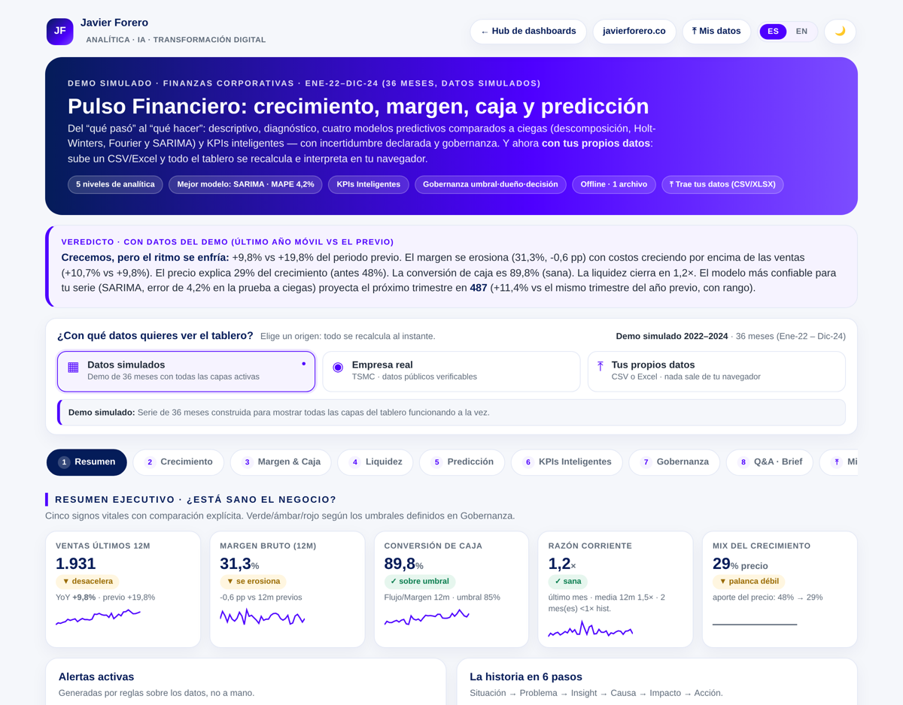

**Español** · [English](README.en.md)

# Pulso Financiero · Dashboard de Finanzas Corporativas

La pregunta que responde no es *“¿cuánto vendimos?”* sino **“¿el negocio está sano y qué decido con eso?”**. Del descriptivo al cognitivo, con la incertidumbre declarada y la decisión gobernada.

> **Nota:** el demo usa datos simulados. El tablero también trae un **caso real verificable** (TSMC) y acepta **tus propios datos**, procesados únicamente en tu navegador.

## Tres orígenes de datos, un mismo motor

| Origen | Qué es | Para qué sirve |
|---|---|---|
| **Datos simulados** | 36 meses construidos para activar todas las capas | Ver el tablero completo funcionando |
| **Empresa real** | TSMC (TWSE 2330 · NYSE TSM), jul-2023 → jun-2026 | Credibilidad: ventas mensuales oficiales y margen bruto trimestral reportado, con fuentes auditables |
| **Tus propios datos** | CSV o Excel, mensual o trimestral | Tu realidad, sin que ningún dato salga de tu equipo |

El selector vive en la cabecera, visible desde que se abre la página. Cambiar de origen recalcula veredicto, KPIs, alertas, los cuatro modelos y el brief.

## Cuatro modelos comparados a ciegas

No existe un modelo bueno para todas las series: existe **el que menos se equivoca con la tuya**. Por eso el tablero no fija uno, los compara:

| Modelo | Qué asume | Cuándo gana |
|---|---|---|
| **Descomposición** | Tendencia lineal + índice estacional estable | Tendencia limpia y estacionalidad regular |
| **Holt-Winters** | Nivel, tendencia y estacionalidad adaptativos | Cuando el negocio cambia de ritmo |
| **Regresión estacional (Fourier)** | Ciclo anual como suma de armónicos; K por AICc | Historia corta o ruidosa |
| **SARIMA (p,1,q)(P,1,Q)ₘ** | Memoria en los errores tras diferenciar | Series con inercia y arrastre |

**Protocolo.** Cada modelo se re-entrena en varios cortes del tiempo (**origen móvil**) y predice a ciegas los periodos siguientes. Los errores —**MAPE, MAE y RMSE**— se promedian y se contrastan contra un **método ingenuo estacional** (repetir el mismo periodo del año anterior). Un modelo que no supera esa referencia no aporta valor, y el tablero lo dice sin adornos.

**Limitación declarada.** Con historias cortas todos los criterios de selección son ruidosos: si dos modelos quedan a menos de ~0,5 puntos de MAPE, la diferencia puede no ser real. El rango mínimo-máximo entre cortes hace visible esa fragilidad.

**Auditabilidad.** Cada modelo muestra su formulación matemática y cada métrica su fórmula, con la trampa correspondiente declarada (el MAPE se dispara cerca de cero; el RMSE es sensible a atípicos).

## Decisiones de diseño (mi criterio, explícito)
- **Pronóstico por indicador, no solo ventas.** Puedes proyectar margen, caja, unidades, precio o razón corriente; los cuatro modelos se re-entrenan sobre la serie elegida. En el demo cada indicador elige un ganador distinto — usar el modelo óptimo para ventas al proyectar la caja sería un error.
- **Mensual y trimestral.** El tablero detecta la periodicidad y **reconfigura toda la estacionalidad** (periodo 12 o 4): medias móviles, ciclo de Holt-Winters, armónicos de Fourier y retardos de SARIMA.
- **Bandas aproximadas, y dicho.** La banda del 80% usa la desviación de los residuos del ajuste; no incorpora la incertidumbre de los parámetros ni se ensancha con el horizonte.
- **KPIs Inteligentes calculados, no pedidos.** Los factores de tendencia y precio se derivan de tus propios datos; no hay que aportar columnas de IA.
- **Cero alucinación.** Ninguna cifra se inventa: lo que el archivo no soporta desactiva su capa y se declara.
- **El Q&A y el brief nombran el modelo que de verdad proyecta.** La cifra del próximo trimestre sale del modelo recomendado por la validación de origen móvil, y se presenta con su MAPE a ciegas frente al ingenuo estacional.
- **Bilingüe desde el origen.** Veredicto, alertas, historia, Q&A, brief, reporte de carga y exportaciones se redactan en español y en inglés; cambiar de idioma reescribe todo sin recargar ni perder tus datos. Las exportaciones en inglés usan encabezados en inglés que el validador vuelve a reconocer.

## Trae tus propios datos

El contrato es mínimo: **el periodo en la primera columna** y después las métricas que quieras.

| Columna | Formato | Uso |
|---|---|---|
| Periodo (1.ª columna) | `AAAA-MM` mensual · `AAAA-QX` trimestral | Requerida — se detecta por posición, con el nombre que sea |
| Ventas | número | Requerida (acepta Ventas, Ingresos, Revenue, Sales…) |
| Costos **o** Margen | número | Requerida (la que falte se deriva) |
| FlujoCaja · Unidades · Precio · Activos y Pasivos Corrientes | número | Opcionales — cada una activa su capa |

No hacen falta columnas de año, mes ni nombre del mes. Al validar, el tablero informa qué columnas reconoció y cuáles ignoró.

**Llévate los resultados.** Como nada se guarda en servidor, el tablero exporta a **Excel (5 hojas: Resumen, Pronóstico, Modelos, Serie y Metodología)** o CSV, con el pronóstico de los cuatro modelos y las fórmulas incluidas.

## Casos de demostración
Cuatro datasets listos para cargar en `casos/`, cada uno con una historia distinta: alerta, turnaround, caso real mensual (TSMC) y caso real trimestral (Apple). Ver [`casos/README.md`](casos/README.md).

## Uso
- **Web:** `index.html` (Plotly 2.35.2 y SheetJS vía CDN, con respaldo multi-CDN). Si ninguna librería de gráficos carga, cifras, narrativa y Q&A siguen funcionando. Mide visitas con Google Analytics 4, la misma propiedad del sitio.
- **Offline:** abre `dashboard-offline.html` con doble clic, sin internet. Lleva Plotly, SheetJS y la tipografía embebidos —así puedes subir tu Excel sin conexión— y excluye la analítica a propósito.
- **Datos:** `data/demo_finanzas.csv` (36 meses del demo). Van embebidos en el HTML; el CSV se publica para transparencia y como plantilla de referencia.

## Tecnología
HTML + CSS + JavaScript vanilla, sin build. [Plotly.js](https://plotly.com/javascript/) 2.35.2 (paquete *finance*, solo los tipos de gráfica que usa el tablero) y [SheetJS](https://sheetjs.com/) 0.20.3, que se descarga solo al subir o exportar un Excel (el archivo offline lo trae embebido). Los cuatro modelos están implementados desde cero en JavaScript —incluidos el ajuste por mínimos cuadrados de Fourier y la estimación SARIMA por suma de cuadrados condicional— para que el tablero siga siendo un único archivo autónomo.

El sistema bilingüe combina un mapa ES→EN para el texto fijo (el español es la clave) con plantillas escritas en ambos idiomas para todo el texto que se calcula. El selector escribe `jf-lang` en `localStorage` y refleja el idioma en la URL (`?lang=en`).

---
**Javier Forero** · [javierforero.co](https://javierforero.co) · [LinkedIn](https://www.linkedin.com/in/jforero/)
