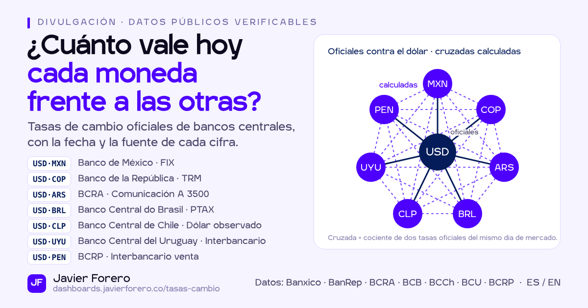

**Español** · [English](README.en.md)

# Tasas de cambio oficiales · México, Colombia, Argentina, Brasil, Chile, Uruguay y Perú

La pregunta que responde: **¿cuánto vale hoy cada moneda frente a las otras y qué tan lejos está de su comportamiento reciente?** Está pensada para quien convierte o factura entre México, Colombia, Argentina, Brasil, Chile, Uruguay y Perú.

> **Datos reales.** Son tasas oficiales de Banco de México, el Banco de la República de Colombia, el BCRA y los bancos centrales de Brasil, Chile, Uruguay y Perú, leídas en vivo desde [`jaforero/fx-bancos-centrales`](https://github.com/jaforero/fx-bancos-centrales). Son tasas de referencia, no de transacción: un banco o una casa de cambio aplicará su propio margen. No constituyen asesoría financiera.

## Recursos
- **Video:** [Hice este Dashboard con Claude Design (Sin Ser Diseñador)](https://youtu.be/zOTZKeb0lCs). Cómo se construyó este tablero, paso a paso, en YouTube.
- **Artículo:** [Claude Dashboards no reemplaza tus tableros: pone a prueba tus datos](https://javierforero.co/2026/10/10/claude-dashboards-analitica-conversacional/). Por qué la respuesta de la IA vale lo que valen las definiciones, la trazabilidad y el gobierno de los datos; usa este tablero como ejemplo.

## Qué muestra
1. **Hoy.** Una lista compacta con una fila por cada serie marcada `primary` en el contrato de datos, en dos grupos: tasas oficiales y cruzadas *calculadas*. Cada fila trae la bandera del país, el valor con su unidad (`quote_unit`), la variación frente al registro oficial anterior y su propia fecha; si la fuente está atrasada o caída, el aviso aparece en la misma fila. Al elegir una fila, el panel de al lado muestra el detalle: fecha completa, días desde el dato, estado de la fuente, fuente citada (o fórmula de la cruzada) y el valor ya publicado para un día futuro, si existe. En las cruzadas, un filtro de una fila muestra solo las de una moneda (Todas · MXN · COP · ARS · BRL · CLP · UYU · PEN). En móvil, las cruzadas se despliegan con un botón.
2. **Histórico.** Debajo del detalle de la tasa elegida: rangos 1M · 3M · 1A · 5A · Todo; escala logarítmica activable. Los fines de semana y festivos se dibujan punteados y cuatro eventos aparecen anotados con su variación calculada sobre los datos.
3. **Base 100.** Las series oficiales contra el dólar parten de 100 desde la fecha elegida, para comparar cuál moneda se depreció más sin el problema de escalas distintas.
4. **Variaciones.** Frente al registro anterior, a 30 días y en lo que va del año, siempre solo con valores oficiales.
5. **Conversor.** Entre las monedas que aparecen en los pares. Indica la fecha de la tasa usada y si es oficial o calculada.
6. **Metodología y fuentes.** Fuentes, metodología de las cruzadas, cómo leer las tasas, la fuente de cada serie y el aviso legal.

## Decisiones de diseño
- **Sin servidor y sin copia de los datos.** La página lee `latest.json` y `rates_daily_compact.json` directamente del repositorio de datos: `raw.githubusercontent.com` es el origen principal y `cdn.jsdelivr.net` el respaldo. Cada visita hace dos peticiones de datos con la cuota de cada visitante.
- **El gráfico en el primer pantallazo.** La lista de tasas va a la izquierda y el detalle con su histórico a la derecha. En una pantalla de 1440×900 se ven el gráfico completo, las 7 tasas oficiales y el filtro de cruzadas sin desplazarse; en 1280×800, casi todo el gráfico. Al bajar por la lista, el detalle y el gráfico quedan fijos a la vista. En móvil, las 7 tasas oficiales caben en la primera pantalla.
- **Banderas para ubicar cada tasa.** Una tasa oficial lleva la bandera del país que la publica (`source.country` del contrato); una cruzada lleva las dos, en el orden del par (MXN-COP: México y Colombia). Son SVG simplificados en línea, sin descargas; la única equivalencia fija es USD → Estados Unidos, y un país sin dibujo se muestra con su código ISO.
- **Primero los KPIs.** `latest.json` (unos 3 KB comprimido) pinta la lista y `rates_daily_compact.json` carga después. Plotly (paquete *cartesian*, un tercio del tamaño del completo) se descarga solo cuando el gráfico entra en pantalla: en escritorio, de inmediato; en móvil, al bajar. Quien solo consulta las tasas no paga la librería.
- **El histórico viaja sin las cruzadas.** `rates_daily_compact.json` trae solo las series oficiales (y los insumos de las cruzadas) en columnas: unos 56 KB comprimidos contra ~252 KB de `rates_daily.json`, y crece ~6 KB por país en vez de ~6 KB por cada cruzada nueva. Las cruzadas se recalculan en el navegador con la misma regla del backend, `Number((numerador / denominador).toFixed(decimales))`, y al cargar se compara el último valor oficial de cada una con el de `latest.json`: si alguno difiere, la página descarta el compacto y carga `rates_daily.json`.
- **La tipografía de marca llega sin mover la página.** Igra Sans se precarga y, mientras llega, el texto usa un respaldo con las métricas de Igra Sans (`size-adjust`, `ascent-override` y `descent-override` sobre Roboto o Arial); la barra superior, el encabezado y los chips tienen un ancho determinista, así que el cambio de fuente no reacomoda el contenido. Medición de laboratorio del 17 de octubre de 2026 (Chromium con Playwright, CPU ×4 y 4G, fuente retrasada 1,5 s; no son datos de usuarios reales): el CLS en móvil en-US pasó de 0,022 a 0,000, y en un barrido de 194 casos (97 anchos de 320 a 1280 px × es/en) la suma bajó de 8,640 a 0,261 y el máximo de 0,417 a 0,025.
- **Ninguna cifra escrita a mano.** Valores, fechas, variaciones, eventos y textos de lectura salen de los JSON. Las únicas listas fijas son los nombres bilingües por id de serie (`SERIES_TR`) y la fecha y la serie de los cuatro eventos.
- **Un país nuevo aparece solo.** La lista, el detalle, la base 100, la tabla y el conversor se construyen con `primarySeriesIds()` y el campo `pair`. La escala log por defecto se decide con los datos (rango histórico ≥ 3×); hoy coincide exactamente con los pares que incluyen ARS.
- **Tasas con dos decimales.** Las cifras de tasas se muestran con dos decimales, o cuatro si la tasa es menor que 1 (CLP-ARS valía ≈ 0,08 en 2020); en la lista, el detalle y las tablas los decimales van en tamaño menor para leer primero la parte entera. El valor oficial con todos sus decimales aparece en el tooltip de cada cifra y es el que usan el conversor y todas las variaciones.
- **Nunca ocultar un dato.** Una serie con error muestra su último valor con un aviso rojo, y las cruzadas que dependen de ella también quedan marcadas.

## Estados
| Situación | Qué muestra |
|---|---|
| Una serie atrasada (`stale`) | Valor con aviso ámbar «Sin publicación desde {fecha}» |
| Una serie con error (`error:*`) | Último valor con aviso rojo «Fuente no disponible» (detalle técnico en el tooltip); las cruzadas dependientes también se marcan |
| Origen principal caído | Carga desde jsDelivr; el pie indica el origen |
| Sin red | Último dato guardado en el navegador con el aviso «Mostrando datos guardados del {fecha}» |
| Contrato distinto de `schema_version` 1.x | Se rechaza; caché con aviso y evento GA4 `fx_contract_error` |
| `rates_daily_compact.json` no se puede leer, tiene otro contrato o una cruzada no coincide con `latest.json` | Carga `rates_daily.json` (todas las tasas, más pesado) y registra el evento GA4 `fx_compact_fallback` |
| `rates_daily.json` también falla | La lista sigue visible; los gráficos muestran un mensaje y un botón Reintentar |

## Archivos
| Archivo | Rol |
|---|---|
| `index.html` | La página: HTML, CSS y JS en un solo archivo |
| `fx-data.js` | Capa de datos sin dependencias: red con timeout y respaldo, validación del contrato, caché y utilidades de fechas y formato |
| `assets/og-image.png` | Imagen social 1200×630 |

## Fuentes
Banco de México (SIE, tipo de cambio FIX) · Banco de la República de Colombia (servicio SDMX, TRM certificada por la Superintendencia Financiera; datos.gov.co como verificación y respaldo) · Banco Central de la República Argentina (API Estadísticas Cambiarias, Comunicación A 3500) · Banco Central do Brasil (API PTAX, tasa de venta) · Banco Central de Chile (API de la Base de Datos Estadísticos, dólar observado) · Banco Central del Uruguay (web service de cotizaciones, dólar interbancario) · Banco Central de Reserva del Perú (API de series estadísticas BCRPData, tipo de cambio interbancario venta). Datos procesados en [`github.com/jaforero/fx-bancos-centrales`](https://github.com/jaforero/fx-bancos-centrales).

Las tasas entre monedas distintas del dólar (MXN-COP, MXN-ARS, ARS-COP y las de BRL, CLP, UYU y PEN) no las publica ningún banco central: se calculan dividiendo dos tasas oficiales contra el dólar formadas el mismo día de mercado.

## Analítica
GA4 `G-MQ3K8EVKV0` con `content_group: 'tasas-cambio'`. Eventos: `fx_pair_select`, `fx_range_select`, `fx_cross_filter`, `fx_convert`, `fx_load_error`, `fx_contract_error`, `fx_compact_fallback`, `lang_switch` y `theme_switch`.

## Uso
Abre `https://dashboards.javierforero.co/tasas-cambio/` (`?lang=en` para inglés). El idioma (`jf-lang`) y el tema claro u oscuro (`jf-theme`) se comparten con el resto del portafolio.
